# AIFV CDSS — AI-IVF Clinical Decision Support System

<p align="center">
  
</p>

<p align="center">
  <strong>Evidence-Based Clinical Decision Support Platform for Individualized Controlled Ovarian Stimulation (COS) in IVF & ICSI</strong>
</p>

<p align="center">
  <a href="https://aifv.vercel.app/"></a>
  <a href="https://www.typescriptlang.org/"></a>
  <a href="https://react.dev/"></a>
  <a href="https://tanstack.com/router/latest"></a>
  <a href="https://tailwindcss.com/"></a>
</p>

<p align="center">
  
  
  
  
  
  
</p>

---

## 📌 Executive Overview

**AIFV CDSS** (_Artificial Intelligence In-Vitro Fertilization Clinical Decision Support System_) is an enterprise-grade, deterministic, evidence-grounded software platform engineered for reproductive endocrinologists, fertility consultants, IVF lab directors, and clinical researchers.

The system standardizes every phase of controlled ovarian stimulation (COS) by integrating:

1. **The Official ESHRE 2025 Guideline Update on Ovarian Stimulation for IVF/ICSI** (_Human Reproduction_, 2026;41(4):498–514; doi: [10.1093/humrep/deag018](https://doi.org/10.1093/humrep/deag018); PMID: [39982461](https://pubmed.ncbi.nlm.nih.gov/39982461/)).
2. **The Active CONSORT Individualized Starting-Dose Nomogram** (_Reprod Biomed Online_, Olivennes et al.) with strict mathematical variable verification and 37.5 IU increments.
3. **POSEIDON Stratification (Groups 1–4, subgroups 1a/1b/2a/2b)** and the **ESHRE Bologna Criteria** for Poor Ovarian Response (POR).
4. **Longitudinal Folliculometry & Hormone Kinetic Monitoring** with automated Day 5/6 mid-cycle dose adjustment rules.
5. **Pre-Ovulatory Maturation & OHSS Safety Engine** governing dual trigger selection, GnRH agonist trigger, freeze-all segmentation, and fresh transfer eligibility.
6. **Unified 16-Section Clinical Intelligence Dossier** with automated multi-variable conflict checking and instant export to EHR-ready PDF, Markdown, JSON, CSV, and TXT formats.

> [!IMPORTANT]
> **Deterministic & Auditable**: AIFV CDSS contains **zero black-box heuristic guesswork**. Every calculation is executed through transparent, published, peer-reviewed clinical algorithms and verified by our Section 9 Safety Firewalls.

---

## 🌐 Live Production Application

- **Live URL**: [https://aifv.vercel.app/](https://aifv.vercel.app/)
- **Hosting Platform**: Vercel Serverless Edge Platform
- **Release Channel**: Synchronized with ESHRE 2025 Guideline Update (Release 2026.25)

---

## 🧭 The Canonical 8-Stage Clinical Decision Workflow

AIFV guides clinicians through an intuitive, sequential **8-Stage Clinical Progression**. The application features an interactive, persistent workflow stepper bar (`WorkflowStepper`) mounted across every module for seamless navigation:

```mermaid
flowchart LR
    S1["Stage 1<br/>Patient Assessment"] --> S2["Stage 2<br/>POSEIDON & Reserve"]
    S2 --> S3["Stage 3<br/>Protocol Selection"]
    S3 --> S4["Stage 4<br/>Starting Dose & CONSORT"]
    S4 --> S5["Stage 5<br/>Monitoring & Titration"]
    S5 --> S6["Stage 6<br/>Trigger & Ovulation"]
    S6 --> S7["Stage 7<br/>Cycle Completion & Safety"]
    S7 --> S8["Stage 8<br/>Intelligence Report"]

    style S1 fill:#E0F2FE,stroke:#0284C7,stroke-width:2px,color:#0369A1
    style S2 fill:#E0E7FF,stroke:#4F46E5,stroke-width:2px,color:#3730A3
    style S3 fill:#EDE9FE,stroke:#7C3AED,stroke-width:2px,color:#5B21B6
    style S4 fill:#FAE8FF,stroke:#C026D3,stroke-width:2px,color:#86198F
    style S5 fill:#FCE7F3,stroke:#DB2777,stroke-width:2px,color:#9D174D
    style S6 fill:#FEE2E2,stroke:#DC2626,stroke-width:2px,color:#991B1B
    style S7 fill:#FFEDD5,stroke:#EA580C,stroke-width:2px,color:#9A3412
    style S8 fill:#DCFCE7,stroke:#16A34A,stroke-width:2px,color:#166534
```



### Workflow Stage Breakdown

| Stage | Name                             | Route                                                                                                                                                             | Core Clinical Purpose & Algorithmic Engines                                                                                                                                                                                                                                                                                |
| :---: | :------------------------------- | :---------------------------------------------------------------------------------------------------------------------------------------------------------------- | :------------------------------------------------------------------------------------------------------------------------------------------------------------------------------------------------------------------------------------------------------------------------------------------------------------------------- |
| **1** | **Patient Assessment**           | [`/assessment`](src/routes/_shell.assessment.tsx)                                                                                                                 | **8-Step Comprehensive Intake Wizard**: Demographics (Age, BMI calculation), Infertility History (Etiology, Duration), Endocrine Biomarkers (AMH, Basal FSH, LH, E2, TSH, PRL), Folliculometry & Baseline AFC, Longitudinal Stimulation, Embryology Yields (MII, 2PN, Blastocysts), Past ART Cycles, and Document Parsing. |
| **2** | **POSEIDON & Phenotyping**       | [`/poseidon`](src/routes/_shell.poseidon.tsx)<br>[`/decision-support`](src/routes/_shell.decision-support.tsx)                                                    | **Prognostic Stratification**: Classifies patients into **POSEIDON Groups 1–4** (including subgroups 1a/1b/2a/2b), checks **ESHRE Bologna Criteria** for POR, and generates an exhaustive Reserve Phenotype Card.                                                                                                          |
| **3** | **Protocol Recommendation**      | [`/protocols`](src/routes/_shell.protocols.tsx)                                                                                                                   | **Protocol Optimization Engine**: Recommends first-line GnRH Antagonist vs GnRH Agonist (Long luteal, Microdose flare, Short) based on ovarian reserve, PCOS diagnosis, and prior cycle history per ESHRE 2025 guidelines.                                                                                                 |
| **4** | **Starting Dose & CONSORT**      | [`/starting-dose`](src/routes/_shell.starting-dose.tsx)<br>[`/consort`](src/routes/_shell.consort.tsx)<br>[`/gonadotropins`](src/routes/_shell.gonadotropins.tsx) | **Individualized Dosing Engine**: Active **CONSORT Nomogram** (FSH, BMI, Age, AFC) + ESHRE 2025 starting dose nomogram (100–300 IU/day) with **unconditional 300 IU/day hard dose ceiling**. Drug regimen selection (rFSH, rLH, hp-hMG).                                                                                   |
| **5** | **Monitoring & Dose Adjustment** | [`/monitoring`](src/routes/_shell.monitoring.tsx)                                                                                                                 | **Longitudinal Kinetics & Titration**: Day 5/6 follicular cohort growth velocity ($<10$, $10-13$, $14-16$, $\ge 17$ mm), Estradiol trajectory, Progesterone elevation tracking, and Step-Up / Step-Down / Coasting rules.                                                                                                  |
| **6** | **Trigger Decision & Safety**    | [`/trigger`](src/routes/_shell.trigger.tsx)                                                                                                                       | **Pre-Ovulatory Maturation & Trigger Engine**: Verifies criteria ($\ge 3$ follicles $\ge 17$ mm), evaluates OHSS risk, and selects trigger agent (hCG, GnRH Agonist, or Dual Trigger).                                                                                                                                     |
| **7** | **Cycle Completion & Safety**    | [`/cycle-completion`](src/routes/_shell.cycle-completion.tsx)                                                                                                     | **Safety Audit & Segmentation Engine**: Comprehensive OHSS scoring (Mild, Moderate, Severe, Critical), Freeze-All cycle segmentation gating, and Fresh Embryo Transfer safety clearance.                                                                                                                                   |
| **8** | **Clinical Intelligence Report** | [`/reports`](src/routes/_shell.reports.tsx)                                                                                                                       | **Master Clinical Dossier**: Synthesizes 16 structured clinical sections, executes multivariable conflict audits, logs missing variables, and produces instant EHR exports.                                                                                                                                                |

---

## 🏛️ System Architecture

AIFV CDSS is architected around a strict unidirectional clinical data pipe with built-in auditability:

```text
┌────────────────────────────────────────────────────────────────────────┐
│                        PRESENTATION LAYER (UI)                         │
│  TanStack Router (25 Routes) │ AppShell (Sidebar & TopNav) │ Stepper  │
│  Radix UI Primitives │ Tailwind CSS v4 │ Recharts Follicular Curves    │
└───────────────────────────────────┬────────────────────────────────────┘
                                    │
┌───────────────────────────────────▼────────────────────────────────────┐
│                       STATE & INTAKE COORDINATION                      │
│  Assessment Hook (Zod Schema Validation) │ LocalStorage Persistence    │
│  Synthetic Patient Fixtures (VP-001, VP-002, VP-003) │ Normalization   │
└───────────────────────────────────┬────────────────────────────────────┘
                                    │
┌───────────────────────────────────▼────────────────────────────────────┐
│                     DETERMINISTIC CLINICAL ENGINES                     │
│  POSEIDON Engine        │ Bologna Engine      │ Phenotyping Engine     │
│  Protocol Matrix        │ Gonadotropin Matrix │ CONSORT Nomogram       │
│  Starting Dose Engine   │ Monitoring Kinetics │ Mid-Cycle Adjuster     │
│  Trigger Decision Engine│ OHSS Risk Scorer    │ Cycle Completion Audit │
└───────────────────────────────────┬────────────────────────────────────┘
                                    │
┌───────────────────────────────────▼────────────────────────────────────┐
│                    SECTION 9 SAFETY FIREWALL & GATEWAY                  │
│  Hard Ceiling Enforcer (300 IU/day) │ OHSS Level 4 Critical Interceptor│
│  Consort Provenance Firewall        │ Missing Variable Fallback Gate   │
└───────────────────────────────────┬────────────────────────────────────┘
                                    │
┌───────────────────────────────────▼────────────────────────────────────┐
│                       EVIDENCE & REPORTING LAYER                       │
│  Verbatim ESHRE 2025 Repository │ PubMed & DOI Cross-Walk Index         │
│  16-Section Intelligence Report │ EHR Export (PDF, MD, JSON, CSV, TXT) │
└────────────────────────────────────────────────────────────────────────┘
```

---

## 📖 ESHRE 2025 Guidelines Synchronization

The entire clinical reasoning system is synchronized with the newly published **ESHRE 2025 Guideline on Ovarian Stimulation for IVF/ICSI** (_Human Reproduction_, 2026;41(4):498–514):

```text
CITATION: The ESHRE Guideline Group on Ovarian Stimulation, Ata B, Bosch E, Broer S, et al.
Ovarian stimulation for IVF/ICSI: guideline of the European Society of Human Reproduction and Embryology.
Hum Reprod. 2026;41(4):498-514. doi: 10.1093/humrep/deag018. PMID: 39982461.
```

### Key Guideline Rules Enforced by the Engines

1. **High Responder Dose Reduction (Recommendation 13 — Conditional, Low Quality ⊕)**:
   - For predicted high responders ($\text{AMH} \ge 3.5\text{ ng/mL}$, $\text{AFC} \ge 18$, or PCOS), starting gonadotropin dose is restricted to **100–125 IU/day** to drastically reduce OHSS incidence while sustaining mature oocyte retrieval.
2. **Normal Responder Stratified Dosing (Recommendation 16 — Strong, Moderate Quality ⊕⊕)**:
   - For normal responders ($\text{AMH } 1.2–3.49\text{ ng/mL}$, $\text{AFC } 8–17$), starting dose defaults to **150–225 IU/day**.
3. **Low Responder Hard Ceiling (Recommendation 20 — Strong, Moderate Quality ⊕⊕)**:
   - For poor responders, POSEIDON Groups 3 & 4, and Bologna POR criteria:
     > _"A gonadotropin dose higher than 300 IU is not recommended for predicted low responders."_
   - Hard ceiling of **300 IU/day** is unconditionally enforced. Doses of 375 IU, 450 IU, or 600 IU are locked out by the engine because RCT evidence demonstrates increased financial burden and medication exposure with zero benefit in oocyte yield or live birth rates.
4. **Rejection of Delayed-Start Protocols (Recommendations 12, 15, 17)**:
   - Delayed-start ovarian stimulation is **not recommended** across all responders (high, normal, and poor). Standard GnRH antagonist protocols are the first-line choice.
5. **Rejection of Estrogen Pre-Treatment (Recommendation 6)**:
   - Estrogen pre-treatment in GnRH antagonist protocols is **not recommended**; it provides no improvement in follicular synchronization or pregnancy rates and prolongs stimulation duration.
6. **Caution on Combined rFSH + hMG Regimens (Recommendation 31)**:
   - Routine combined use of r-hFSH and hMG is not recommended over monotherapy.

---

## 🧮 CONSORT Starting Dose Calculator & Safety Firewall

The **CONSORT Individualized r-hFSH Starting Dose Nomogram** (_Olivennes et al., Reprod Biomed Online_) is fully implemented and active in [`src/lib/engine/consort-model.ts`](src/lib/engine/consort-model.ts) and [`src/lib/engine/consort-dose.ts`](src/lib/engine/consort-dose.ts).

### Predictive Model Matrix

The model assigns integer points across 4 baseline clinical variables:

| Variable                   | Band 0 (0 pts) | Band 1 (1 pt) | Band 2 (2 pts) | Band 3 (3 pts) |
| :------------------------- | :------------: | :-----------: | :------------: | :------------: |
| **Basal FSH (IU/L)**       |    $< 6.0$     |  $6.0 - 8.9$  |  $9.0 - 11.9$  |   $\ge 12.0$   |
| **BMI ($\text{kg/m}^2$)**  |    $< 20.0$    | $20.0 - 24.9$ | $25.0 - 29.9$  |   $\ge 30.0$   |
| **Age (years)**            |     $< 30$     |   $30 - 34$   |   $35 - 39$    |    $\ge 40$    |
| **Antral Follicles (AFC)** |    $\ge 16$    |   $10 - 15$   |    $5 - 9$     |     $< 5$      |

### Score-to-Dose Crosswalk (37.5 IU Increments)

$$\text{Total Score} = \text{Score}_{\text{FSH}} + \text{Score}_{\text{BMI}} + \text{Score}_{\text{Age}} + \text{Score}_{\text{AFC}}$$

- **0 – 1 points**: $112.5\text{ IU/day}$
- **2 – 3 points**: $150.0\text{ IU/day}$
- **4 – 5 points**: $187.5\text{ IU/day}$
- **6 – 7 points**: $225.0\text{ IU/day}$
- **8 – 9 points**: $262.5\text{ IU/day}$
- **10 – 12 points**: $300.0\text{ IU/day}$ _(Enforcing the ESHRE 300 IU ceiling)_

> [!NOTE]
> **Firewall Isolation**: The CONSORT algorithm is strictly isolated. If any variable is missing, the engine gracefully yields `status: "missing-variables"` and safely falls back to the ESHRE 2025 reserve stratification without system interruption.

---

## 📊 The 16 Sections of the Clinical Intelligence Dossier

The Master Intelligence Dossier compiles a comprehensive, print-ready record for the patient's medical file:

1. **Patient Summary & Anthropometrics**: Age, BMI classification, gravidity, parity, baseline vitals.
2. **Infertility History & Etiology**: Primary/secondary classification, duration, previous treatments.
3. **Ovarian Reserve Biomarkers**: AMH, basal FSH, LH, E2, TSH, prolactin with reference interpretations.
4. **Folliculometry & Baseline Ultrasound**: Left/right ovary AFC, resting cohort distribution, antral metrics.
5. **Previous ART Cycle Analysis**: Prior protocols, total gonadotropin exposure, oocyte yield, fertilisation rate.
6. **Reserve Categorization & Phenotype**: Multidimensional phenotype categorization and hyper/hypo-response risk.
7. **POSEIDON Classification**: Groups 1a, 1b, 2a, 2b, 3, or 4 with specific expected prognosis.
8. **Bologna POR Criteria**: Verification of consensus criteria for Poor Ovarian Response.
9. **Predicted Ovarian Response**: Estimated mature oocyte yield, optimal range ($10–15$), hypo/hyper risk.
10. **Stimulation Protocol Selection**: Antagonist vs Agonist selection with ESHRE 2025 rationale.
11. **Gonadotropin Selection & Adjuvants**: rFSH vs hp-hMG vs rLH decision matrix with LH-deficit evaluation.
12. **CONSORT Starting Dose Nomogram**: Exact points breakdown and 37.5 IU increment dose calculation.
13. **Starting Dose Determination**: Final evidence-gated starting dose with 300 IU/day poor responder ceiling.
14. **Follicular Kinetics & Longitudinal Monitoring**: Visit-by-visit follicle progression and hormone dynamics.
15. **Cycle Completion & OHSS Safety Audit**: Pre-ovulatory trigger choice, OHSS risk tier, and freeze-all segmentation.
16. **Data Completeness & Evidence Register**: Missing variable audit, conflict logs, and Vancouver-style references.

---

## 💻 Tech Stack & Engineering Standards

- **Core Framework**: React 19 (`react@^19.2.0`, `react-dom@^19.2.0`)
- **Application Server & Router**: TanStack Start & TanStack Router (`@tanstack/react-router@^1.170.18`, `@tanstack/react-start@^1.168.32`)
- **Query & Cache**: TanStack Query (`@tanstack/react-query@^5.101.1`)
- **Styling Architecture**: Tailwind CSS v4 (`@tailwindcss/vite@^4.2.1`)
- **UI Primitives**: Radix UI Accessible Components (Dialog, Tabs, Accordion, Dropdown, Slider, Switch, Tooltip)
- **Data Visualization**: Recharts (`recharts@^2.15.4`)
- **Type Checking**: Strict TypeScript 5.8 (`typescript@^5.8.3`)
- **Validation Schemas**: Zod (`zod@^3.24.2`) & React Hook Form (`react-hook-form@^7.71.2`)
- **Icons**: Lucide React (`lucide-react@^0.575.0`)
- **Build System**: Vite 8 (`vite@^8.2.0`) with Nitro Engine

---

## 🗂️ Repository Directory Structure

```text
ai-ivf-cdss/
├── public/                                # Static web assets & favicons
├── scripts/                               # CLI Automated Verification Suites
│   ├── e2e-negative-boundary-audit.ts    # 37-assertion negative boundary & firewall test harness
│   ├── engine-audit.ts                   # 14-engine synthetic execution test
│   ├── run-complete-patient-workflow.ts  # End-to-end 8-stage clinical patient simulation
│   └── test-3-virtual-patients.ts        # Virtual patient test cohort (VP-001, VP-002, VP-003)
├── src/
│   ├── components/                        # UI Components
│   │   ├── app-shell.tsx                 # Main layout shell, sidebar & top navbar
│   │   ├── workflow-stepper.tsx          # 8-stage clinical workflow stepper bar
│   │   ├── brand-mark.tsx                # Brand mark and clinic logo component
│   │   ├── page-header.tsx               # Standardized page headers with stage tags
│   │   ├── section-card.tsx              # Card containers with clinical styling
│   │   ├── assessment/                   # 8 intake wizard step components
│   │   ├── engine/                       # Clinical engine interactive UI panels
│   │   ├── report/                       # 16-section intelligence report & export views
│   │   └── ui/                           # Radix UI design system primitives
│   ├── data/
│   │   └── evidence-repository.ts        # Official ESHRE 2025 guideline records with PMIDs/DOIs
│   ├── hooks/                            # Custom React hooks (Theme, Mobile, Clinic Settings)
│   ├── lib/                              # Core Business & Clinical Intelligence Logic
│   │   ├── assessment/                   # Patient Zod schemas, state, and validation
│   │   ├── clinical/
│   │   │   ├── data-mapping.ts           # Clinical data transformers & normalizers
│   │   │   ├── knowledge-model.ts        # Knowledge graph definitions
│   │   │   └── workflow-stages.ts        # Canonical 8-Stage Clinical Workflow definitions
│   │   ├── engine/                       # 18+ Clinical Decision Engines
│   │   │   ├── poseidon.ts               # POSEIDON Groups 1–4 classification
│   │   │   ├── bologna.ts                # Bologna POR criteria evaluation
│   │   │   ├── phenotype.ts              # Ovarian reserve phenotyping
│   │   │   ├── ovarian-response.ts       # Expected response & yield predictor
│   │   │   ├── protocol-recommendation.ts# ESHRE 2025 protocol selection
│   │   │   ├── gonadotropin-selection.ts # Drug regimen selector (rFSH, rLH, hMG)
│   │   │   ├── consort-model.ts          # CONSORT nomogram table & points crosswalk
│   │   │   ├── consort-dose.ts           # CONSORT starting dose calculator
│   │   │   ├── starting-dose.ts          # ESHRE starting dose nomogram & 300 IU ceiling
│   │   │   ├── monitoring.ts             # Folliculometry kinetics & growth tracking
│   │   │   ├── dose-adjustment.ts        # Mid-cycle step-up / step-down / coasting
│   │   │   ├── trigger.ts                # Pre-ovulatory trigger & OHSS prevention
│   │   │   └── cycle-completion.ts       # Retrospective safety audit & freeze-all gateway
│   │   ├── evidence/                     # Evidence database, master pack, and topic links
│   │   └── report/
│   │       └── intelligence-report.ts    # 16-section unified clinical dossier generator
│   └── routes/                           # 25 TanStack File-Based Routes
│       ├── __root.tsx                    # HTML document root with router context
│       ├── index.tsx                     # Landing page & 8-stage pipeline showcase
│       ├── _shell.tsx                    # Protected shell layout wrapper
│       ├── _shell.dashboard.tsx          # Clinical dashboard with stage launch cards
│       ├── _shell.assessment.tsx         # Stage 1: Patient Assessment Wizard
│       ├── _shell.poseidon.tsx           # Stage 2: POSEIDON Classification
│       ├── _shell.decision-support.tsx   # Stage 2: Patient Reserve Phenotype
│       ├── _shell.protocols.tsx          # Stage 3: Protocol Recommendation
│       ├── _shell.starting-dose.tsx      # Stage 4: Starting Gonadotropin Dose
│       ├── _shell.consort.tsx            # Stage 4: CONSORT Dose Nomogram
│       ├── _shell.gonadotropins.tsx      # Stage 4: Gonadotropin Selection Matrix
│       ├── _shell.monitoring.tsx         # Stage 5: Folliculometry Kinetics & Titration
│       ├── _shell.trigger.tsx            # Stage 6: Pre-Ovulatory Trigger Decision
│       ├── _shell.cycle-completion.tsx   # Stage 7: Cycle Completion & Safety Audit
│       ├── _shell.reports.tsx            # Stage 8: Clinical Intelligence Dossier
│       ├── _shell.calculator.tsx         # Rapid Clinical Calculator
│       ├── _shell.patients.tsx           # Patient Roster & Records Directory
│       ├── _shell.patient.$id.tsx        # Individual Patient History & Records
│       ├── _shell.evidence.tsx           # Evidence Library Database Explorer
│       ├── _shell.evidence_.$id.tsx      # Individual Evidence Reference Detail View
│       ├── _shell.evidence-master.tsx    # Evidence Master Index & Guideline Corpus
│       ├── _shell.evidence-requirements.tsx # Evidence Gap Analysis & Requirements Register
│       ├── _shell.evidence-updates.tsx   # Evidence Updates Log
│       ├── _shell.evidence-governance.tsx# Clinical Algorithm Governance & Overrides
│       ├── _shell.system-test.tsx        # In-Browser System Verification Suite
│       ├── _shell.favorites.tsx          # Saved Protocols & Patients
│       ├── _shell.settings.tsx           # Clinic Branding, Logo & Preferences
│       └── _shell.help.tsx               # Clinical Help & Documentation
├── eslint.config.js                      # ESLint configuration
├── tsconfig.json                         # Strict TypeScript configuration
├── vite.config.ts                        # Vite 8 configuration
└── package.json                          # Package dependencies & scripts
```

---

## ⚡ Quick Start & Local Development

### Prerequisites

- **Node.js**: `v20.x` or `v22.x` (LTS recommended)
- **Package Manager**: `npm` (v9+) or `bun`

### Installation & Setup

1. **Clone the repository**:

   ```bash
   git clone https://github.com/<your-org>/ai-ivf-cdss.git
   cd ai-ivf-cdss
   ```

2. **Install dependencies**:

   ```bash
   npm install
   ```

3. **Start the local development server**:

   ```bash
   npm run dev
   ```

   Open your browser at `http://localhost:8080` (or `http://localhost:5173`).

4. **Compile production build**:

   ```bash
   npm run build
   ```

5. **Preview production build locally**:
   ```bash
   npm run preview
   ```

---

## 🧪 Automated Clinical Test Suites

The repository contains automated CLI test suites to verify algorithmic determinism, negative boundary defense, and safety firewalls:

### 1. E2E Negative Boundary & Safety Firewall Audit (37 Assertions)

Tests graceful degradation on missing records, sparse folliculometry, physiological anomalies (negative AMH, excessive AFC), POSEIDON edge cases, and Section 9 safety firewalls:

```bash
npx tsx --tsconfig tsconfig.json scripts/e2e-negative-boundary-audit.ts
```

```text
================================================================================
TOTAL AUDIT ASSERTIONS: 37
PASSED: 37 | FAILED: 0 (100% PASS RATE)
================================================================================
```

### 2. End-to-End Virtual Patient Simulation (Stages 1 – 8)

Simulates a complete clinical lifecycle from intake through to final dossier generation:

```bash
npx tsx --tsconfig tsconfig.json scripts/run-complete-patient-workflow.ts
```

### 3. Static Type Safety & Code Quality Checks

```bash
# Verify 100% TypeScript type safety
npx tsc --noEmit

# Run ESLint linter
npm run lint
```

---

## 📄 EHR Interoperability & Report Exports

From **Stage 8: Clinical Intelligence Report** ([`/reports`](src/routes/_shell.reports.tsx)), clinicians can export the compiled patient record into multiple formats for immediate inclusion in Electronic Health Record (EHR) systems:

- 🖨️ **Print / PDF**: Beautifully formatted multi-page clinical dossier with page breaks and clinic logo.
- 📝 **Markdown (`.md`)**: GitHub Flavored Markdown for clinical wikis or digital patient charts.
- 📋 **Plain Text (`.txt`)**: Clean ASCII clinical summary for legacy hospital information systems.
- 💾 **Machine-Readable JSON (`.json`)**: Complete patient context, scores, and calculated dosing vectors.
- 📊 **Spreadsheet CSV (`.csv`)**: Structured tabular data of longitudinal folliculometry visits and hormone kinetics.

---

## ⚙️ Custom Clinic Branding & Settings

Clinics can customize the application's appearance through the **Settings Page** ([`/settings`](src/routes/_shell.settings.tsx)):

- **Custom Clinic Logo Upload**: Upload high-resolution PNG, JPG, or SVG logos (up to 5MB). Logos are stored via client-side storage and rendered in the top navigation bar and printed PDF reports.
- **Clinic Name & Location**: Dynamic branding for international practices.
- **Unit Preferences**: Toggle between SI units (e.g. pmol/L) and conventional units (e.g. pg/mL, ng/mL).
- **Theme Selection**: Dark Mode, Light Mode, or System Auto.

---

## 🔒 Data Privacy & Security

- **Client-Side Processing**: Patient assessment data is stored locally in the browser (`localStorage`) and never transmitted to external third-party AI services.
- **Zero Cloud Leakage**: All mathematical models, nomograms, and classification rules execute locally in the client runtime.
- **HIPAA / GDPR Ready**: Facilitates anonymized or pseudo-anonymized research workflows with one-click synthetic test patient switching (VP-001, VP-002, VP-003).

---

## ⚖️ Clinical Disclaimer

> [!WARNING]
> **Clinical Decision Support Notice**
>
> AIFV CDSS is an evidence-based clinical decision support tool designed strictly to assist licensed reproductive endocrinologists, fertility specialists, and gynecologists. It does **not** replace independent clinical judgment, personalized diagnostic evaluations, or direct medical consultation.
>
> Prescribing decisions, gonadotropin starting doses, mid-cycle dose adjustments, trigger selection, and OHSS prevention protocols remain the sole responsibility of the treating physician.

---

## 📜 License

Distributed under the **MIT License**. See `LICENSE` for more information.

---

<p align="center">
  <strong>AIFV CDSS — Precision Ovarian Stimulation Guided by Evidence</strong><br />
  European Society of Human Reproduction and Embryology (ESHRE) 2025 Synchronized
</p>
